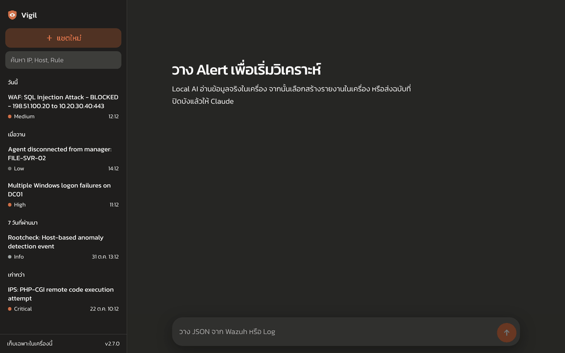
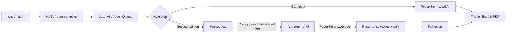
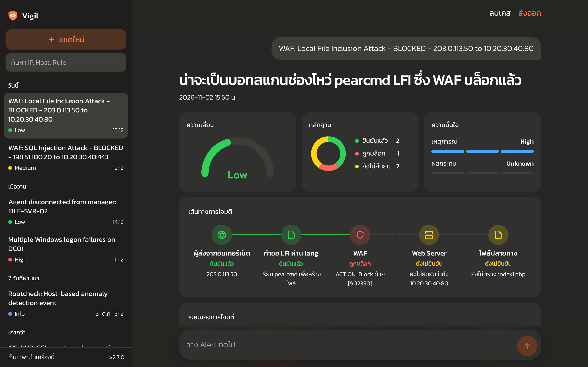
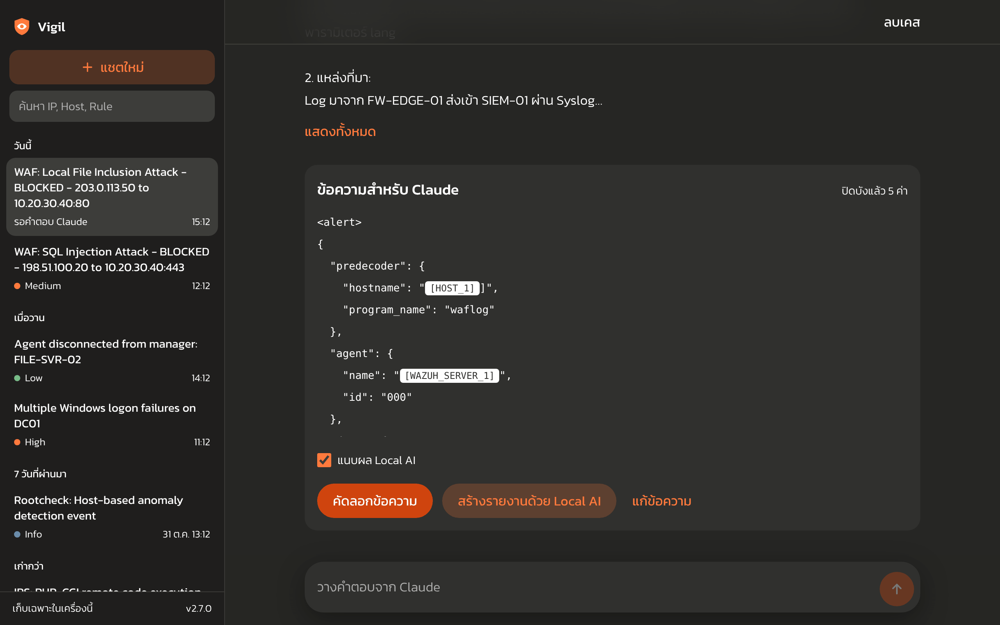
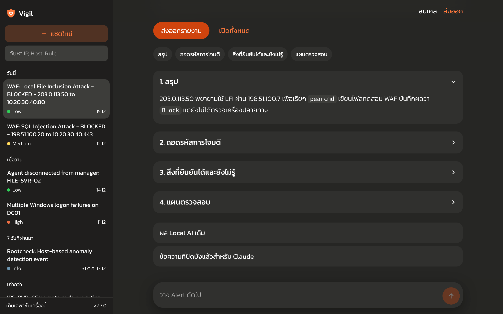
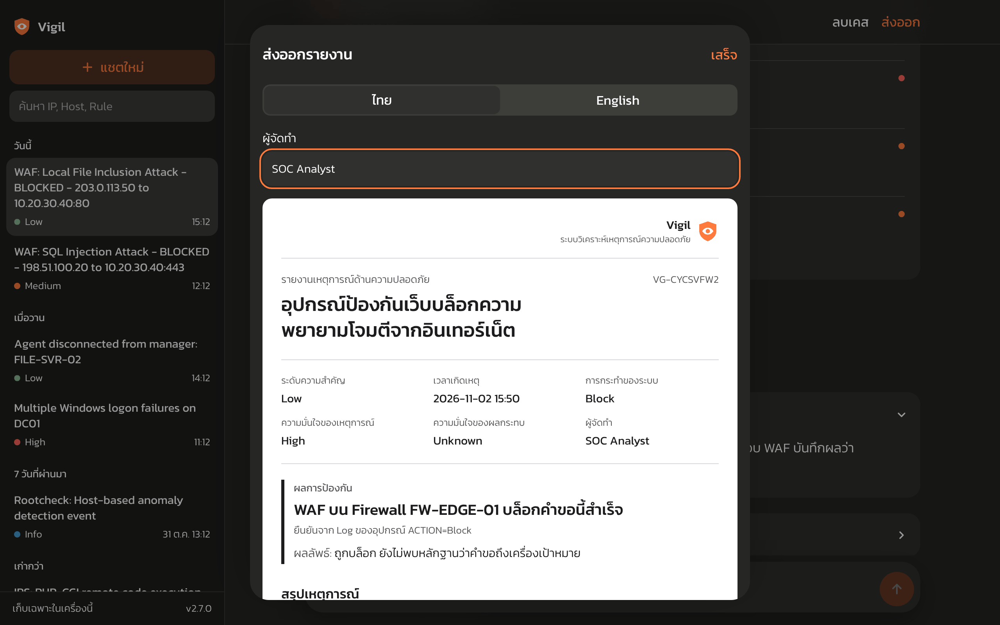

<p align="center"></p>
<h1 align="center">Vigil</h1>
<p align="center"><b>Local-first security alert analysis for small IT and SOC teams.</b><br>Paste a Wazuh alert, get a plain-language analysis and a report your manager can read.</p>
<p align="center">
  <a href="https://github.com/mroatder/vigil-soc/actions/workflows/build.yml"></a>
  <a href="https://github.com/mroatder/vigil-soc/releases/latest"></a>
  <a href="LICENSE"></a>
</p>



> Every screen and report in this README uses simulated data. The IP addresses come from documentation ranges, and the host names are made up.

## Why it exists

Reading alerts takes time, and a small IT team rarely has a SOC analyst on call. Cloud AI is strong at explaining logs, but real IP addresses and host names should not leave the network.

Vigil keeps the real data on your computer. A Local AI reads it first. You can stop there, or send a masked copy to any external AI (Claude, ChatGPT, Gemini, or others) for a deeper second opinion. The answer comes back with the real values restored on your machine.

## What it does

- **Analyzes any Wazuh alert** with a local Ollama model, so the alert never leaves your computer.
- **Masks sensitive values** such as IP addresses, host names, users, email addresses, and secrets before anything is copied out. A final check blocks the copy if a real value remains.
- **Shows the attack visually** with a risk gauge, evidence status, attack path, kill chain view, and investigation checklist.
- **Exports a Thai or English PDF report** that states who did what, who stopped it, the impact, and what is still unconfirmed.
- **Reads the defense result directly from the log**, so "blocked" in a report never depends on what a model wrote.
- **Keeps case history** on your computer, with search by IP, host, or rule.

## How it works



Only the masked text can leave your computer, and only when you copy or download it. You can paste it into any AI (Claude, ChatGPT, Gemini, or others), then paste the answer back to restore the real values. There is also an optional direct API mode if `ANTHROPIC_API_KEY` is set.

## Screens

| Case view | Masked text for review |
|---|---|
|  |  |

| Analysis sections | Report export |
|---|---|
|  |  |

See a full [sample PDF report](docs/sample-report-th.pdf).

## What you need

### To use Vigil

| Tool | Required | Used for |
|---|---|---|
| Windows 10 or 11, 64-bit | Yes | Running the installer |
| [Ollama](https://ollama.com) | Yes | Running the Local AI on your computer |
| An Ollama model | Yes | Analyzing alerts. Create `log-analyst-q35` from [Modelfile.example](Modelfile.example) |
| A modern web browser | Yes | Showing the app and saving reports as PDF |
| [Wazuh](https://wazuh.com) | Recommended | Supplying alert JSON. Other log text can also be pasted |
| An external AI account | Optional | The second opinion (Claude, ChatGPT, Gemini, or others), through copy-and-paste or the downloaded .md file |
| Anthropic API key | Optional | Sending masked text directly from the app |

A GPU is not required by Vigil itself, but it makes the Local AI much faster. Development used an NVIDIA RTX 3050 with 6 GB of memory and `qwen3.5:4b`, and larger alerts can take a minute or more.

### To build from source

| Tool | Version | Used for |
|---|---|---|
| [Git](https://git-scm.com) | Any recent version | Getting the code |
| [Python](https://www.python.org) | 3.12 | Running the app. No Python packages are needed |
| [Node.js](https://nodejs.org) and npm | 20 | Building the web interface |
| [PyInstaller](https://pyinstaller.org) | Latest | Building `Vigil.exe` |
| [Inno Setup](https://jrsoftware.org/isinfo.php) | 6 | Building the installer |

`npm ci` installs the web tools for you: Vue 3, Vite, Tailwind CSS, and the Kanit font.

## Install on Windows

1. Install [Ollama](https://ollama.com), then create the model:

   ```bat
   ollama pull qwen3.5:4b
   ollama create log-analyst-q35 -f Modelfile.example
   ```

2. Download `VigilSetup` from the [latest release](https://github.com/mroatder/vigil-soc/releases/latest) and run it. It needs no administrator rights.
3. Open Vigil from the Start menu. The app runs in the background and opens in your browser.
4. To stop it, choose **ปิดโปรแกรม** at the bottom of the left panel. Closing the browser tab leaves it running.

The installer is not code signed, so Windows SmartScreen may show a warning. Choose **More info**, then **Run anyway**, or build from source.

## Configure

Private files live in `%LOCALAPPDATA%\Vigil` and are never part of this repository.

| File | Purpose |
|---|---|
| `mask_terms.txt` | Host and company names to mask, one `value\|ROLE` per line |
| `environment.txt` | What the external AI should know about your network, using placeholders only |
| `company-logo.png` | Optional logo for the top left of exported reports |
| `history.db` | Case history. It holds real alert data in plain text, so keep it private |

Uninstalling leaves this folder in place, so delete it yourself to remove your data.

| Environment variable | Default |
|---|---|
| `OLLAMA_MODEL` | `log-analyst-q35` |
| `OLLAMA_URL` | `http://127.0.0.1:11434/api/chat` |
| `ALERT_CONSOLE_PORT` | `8765` |
| `VIGIL_DATA_DIR` | `%LOCALAPPDATA%\Vigil` for the installed app |

## Run from source

```bash
cd web
npm ci
npx vite build
cd ..
python alert_console.py
```

From source, private files stay beside `alert_console.py`, and `.gitignore` excludes them.

```bash
python test_alert_console.py
node web/tests/facts.test.mjs
```

Run `build_exe.bat` to build `dist\Vigil.exe`. GitHub Actions tests each push on Windows, starts the built program, and publishes the installer.

## Security design

- Binds to `127.0.0.1` only, checks the `Host` header, and requires a per-run token for every API call.
- Sets a strict Content Security Policy, loads no external scripts or fonts, and renders alert text as text, never as HTML.
- Treats alert content as untrusted data in every AI prompt.
- Overwrites deleted cases in the database with SQLite `secure_delete`.

## Limits

- Masking reduces risk but cannot catch everything. Review the masked text before you copy it, and list your own host names in `mask_terms.txt`.
- AI output can be wrong. Check high-severity cases yourself. Local AI reports state that no external AI has reviewed them.
- A blocked request proves only what the device logged. Confirming that a host is safe still needs its own logs.
- Vigil explains alerts you give it. It is not a SIEM, and it does not detect events or change firewall rules.

## ภาษาไทย

Vigil คือเครื่องมือวิเคราะห์ Alert จาก Wazuh ที่ทำงานในเครื่องของคุณ Local AI อ่านข้อมูลจริงก่อน แล้วเลือกได้ว่าจะสร้างรายงานในเครื่อง หรือส่งฉบับที่ปิดบัง IP และ Hostname แล้วให้ AI ภายนอก (Claude, ChatGPT, Gemini หรือตัวอื่น) วิเคราะห์ต่อ โดยคัดลอกข้อความหรือดาวน์โหลดเป็นไฟล์ .md แล้วนำคำตอบมาวางกลับในแอป จากนั้นแปลงกลับเป็นข้อมูลจริงในเครื่อง และส่งออกรายงาน PDF ไทยหรืออังกฤษสำหรับผู้บริหารได้

ดาวน์โหลดตัวติดตั้งได้จากหน้า [Releases](https://github.com/mroatder/vigil-soc/releases/latest)

## License

[MIT](LICENSE)
